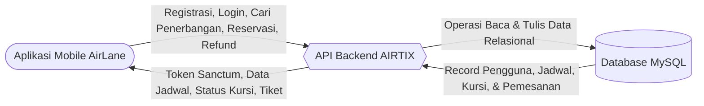
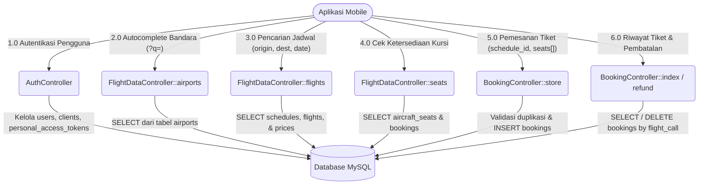
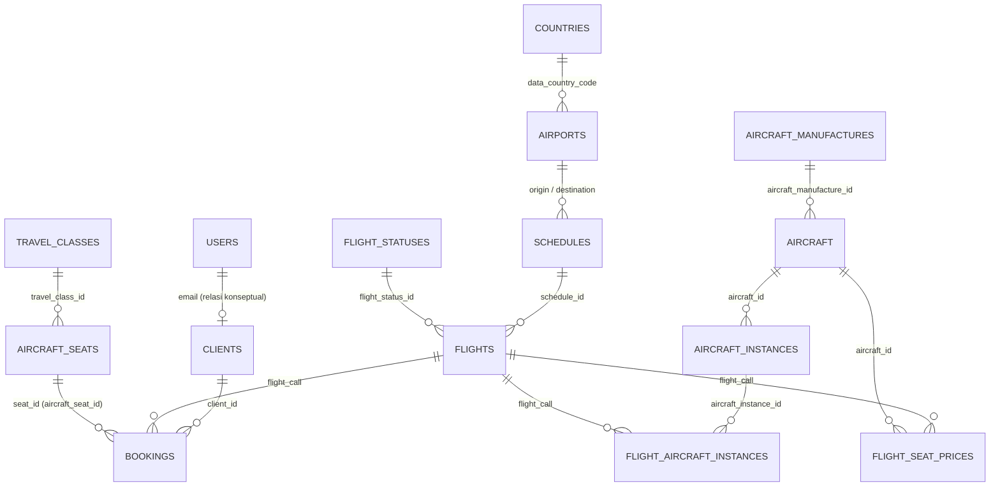

# DOKUMENTASI SISTEM & API BACKEND AIRTIX
### Sistem Reservasi Tiket Penerbangan Domestik Indonesia


Dokumentasi komprehensif untuk backend sistem **AIRTIX**, sebuah platform pemesanan tiket penerbangan domestik Indonesia (melayani bandara utama: CGK, DPS, SUB, KNO, UPG, BPN, YIA, dan SOC). Sistem ini menyediakan antarmuka web serta **RESTful API** berkinerja tinggi yang diamankan menggunakan **Laravel Sanctum Bearer Token** untuk diintegrasikan dengan aplikasi mobile maupun klien eksternal lainnya.

---

## Daftar Isi

- [1. Ringkasan Sistem & Masalah Bisnis](#1-ringkasan-sistem--masalah-bisnis)
  - [1.1 Tujuan Sistem](#11-tujuan-sistem)
  - [1.2 Masalah Bisnis & Solusi Teknis](#12-masalah-bisnis--solusi-teknis)
- [2. Spesifikasi Teknis & Lingkungan](#2-spesifikasi-teknis--lingkungan)
  - [2.1 Tech Stack](#21-tech-stack)
  - [2.2 Struktur Direktori Proyek](#22-struktur-direktori-proyek)
- [3. Skema Basis Data (Data Dictionary)](#3-skema-basis-data-data-dictionary)
  - [3.1 Entitas Pengguna & Klien](#31-entitas-pengguna--klien)
  - [3.2 Entitas Penerbangan & Wilayah](#32-entitas-penerbangan--wilayah)
  - [3.3 Entitas Armada Pesawat & Kursi](#33-entitas-armada-pesawat--kursi)
  - [3.4 Entitas Transaksi Pemesanan](#34-entitas-transaksi-pemesanan)
- [4. Diagram Arsitektur & Alur Data](#4-diagram-arsitektur--alur-data)
  - [4.1 Data Flow Diagram (DFD) Level 0](#41-data-flow-diagram-dfd-level-0)
  - [4.2 Data Flow Diagram (DFD) Level 1](#42-data-flow-diagram-dfd-level-1)
  - [4.3 Entity Relationship Diagram (ERD)](#43-entity-relationship-diagram-erd)
- [5. Konfigurasi Kabin & Spesifikasi Kursi](#5-konfigurasi-kabin--spesifikasi-kursi)
  - [5.1 Layout Formasi 152 Kursi](#51-layout-formasi-152-kursi)
  - [5.2 Algoritma Konversi Nomor Kursi](#52-algoritma-konversi-nomor-kursi)
- [6. Dokumentasi Lengkap REST API](#6-dokumentasi-lengkap-rest-api)
  - [6.1 Format Respons Standar](#61-format-respons-standar)
  - [6.2 Ringkasan Endpoint](#62-ringkasan-endpoint)
  - [6.3 Detail Endpoint Autentikasi](#63-detail-endpoint-autentikasi)
  - [6.4 Detail Endpoint Pencarian Data](#64-detail-endpoint-pencarian-data)
  - [6.5 Detail Endpoint Reservasi & Tiket](#65-detail-endpoint-reservasi--tiket)
- [7. Dokumentasi Fungsi & Logika Kode Internal](#7-dokumentasi-fungsi--logika-kode-internal)
  - [7.1 AuthController](#71-authcontroller)
  - [7.2 FlightDataController](#72-flightdatacontroller)
  - [7.3 BookingController](#73-bookingcontroller)
  - [7.4 AirtixSeeder](#74-airtixseeder)
- [8. Panduan Pengujian API (cURL Workflow)](#8-panduan-pengujian-api-curl-workflow)
- [9. Analisis Performa & Panduan Optimasi](#9-analisis-performa--panduan-optimasi)
  - [9.1 Hasil Pengukuran Kecepatan](#91-hasil-pengukuran-kecepatan)
  - [9.2 Solusi Bottleneck N+1 Query](#92-solusi-bottleneck-n1-query)
  - [9.3 Rekomendasi Indexing Database](#93-rekomendasi-indexing-database)
- [10. Panduan Instalasi & Deployment Lokal](#10-panduan-instalasi--deployment-lokal)

---

## 1. Ringkasan Sistem & Masalah Bisnis

### 1.1 Tujuan Sistem
Backend AIRTIX dirancang untuk menyediakan layanan transaksi penerbangan yang cepat, konsisten, dan aman:
- Mengelola data master rute, jadwal, dan ketersediaan armada pesawat domestik.
- Memberikan akses API pencarian penerbangan realtime dengan filter bandara asal, tujuan, dan tanggal keberangkatan.
- Menangani reservasi multi-kursi secara akurat dengan proteksi anti pemesanan ganda (*double-booking*).
- Menyediakan transparansi riwayat pemesanan serta mekanisme pembatalan (*refund*) instan.

### 1.2 Masalah Bisnis & Solusi Teknis

| Tantangan Bisnis | Solusi pada Arsitektur Airtix |
|---|---|
| **Data rute tersebar dan lambat dicari** | Inisialisasi deterministik 8 bandara utama dan 14 rute terpopuler dengan relasi asal-tujuan yang terindeks, dapat diakses instan melalui `GET /api/flights`. |
| **Inkonsistensi harga antar kelas kabin** | Penentuan harga dinamis per kursi per penerbangan di tabel `flight_seat_prices`, mencakup kelas *First*, *Business*, dan *Economy*. |
| **Pemesanan kursi ganda oleh pengguna** | Validasi integritas kursi di layer controller sebelum penulisan ke tabel `bookings` untuk memastikan kursi yang dipilih belum dipesan oleh klien pada nomor penerbangan tersebut. |
| **Pemisahan akun sistem & identitas penumpang** | Pengelolaan autentikasi ditangani oleh model `User` (Sanctum), sementara profil penumpang disimpan pada model `Client`, dihubungkan secara otomatis melalui verifikasi alamat email. |
| **Inisialisasi lingkungan pengujian lambat** | Script `AirtixSeeder` menghasilkan 152 kursi, 98 jadwal, 98 penerbangan, dan 14.896 entri harga secara otomatis dan idempotent (aman dieksekusi berulang). |

---

## 2. Spesifikasi Teknis & Lingkungan

### 2.1 Tech Stack

| Komponen | Spesifikasi / Paket | Kegunaan |
|---|---|---|
| **Bahasa Pemrograman** | PHP **^8.3** (ZTS / NTS VC++ 2019) | Bahasa backend utama |
| **Framework Backend** | Laravel Framework **13.2.0** | Kerangka kerja aplikasi MVC & REST API |
| **Database Engine** | MySQL **8.4.x** (Laragon Engine) | Relational Database Management System |
| **Autentikasi API** | Laravel Sanctum **^4.3** | Autentikasi berbasis Bearer Token |
| **OAuth Eksternal** | Laravel Socialite **^5.27** | Integrasi autentikasi Google Sign-In |
| **Manajer Ketergantungan** | Composer **^2.7** | Manajemen paket PHP |
| **Pengujian & Dev Tool** | PHPUnit 12, Pint, Pail, Tinker | Pengujian unit, code style fixer, dan logger |

### 2.2 Struktur Direktori Proyek

```text
Airtix-main/
├── app/
│   ├── Http/
│   │   └── Controllers/
│   │       ├── Api/                     # Controller RESTful API (Klien Mobile)
│   │       │   ├── AuthController.php
│   │       │   ├── BookingController.php
│   │       │   └── FlightDataController.php
│   │       ├── AuthController.php       # Controller Web (Blade Views)
│   │       ├── Controller.php           # Base Controller
│   │       └── FlightController.php     # Controller Web Penerbangan
│   └── Models/                          # Model Eloquent ORM
│       ├── Aircraft.php
│       ├── Aircraft_instance.php
│       ├── Aircraft_manufactures.php
│       ├── Aircraft_seat.php
│       ├── Airport.php
│       ├── Booking.php
│       ├── Client.php
│       ├── Country.php
│       ├── Direction.php
│       ├── Flight.php
│       ├── Flight_aircraft_instance.php
│       ├── Flight_seat_price.php
│       ├── Flight_status.php
│       ├── Schedule.php
│       ├── Travel_class.php
│       └── User.php
├── bootstrap/
│   └── app.php                          # Inisialisasi pipeline, routing, & exception
├── config/                              # Konfigurasi aplikasi (auth, database, dll)
├── database/
│   ├── migrations/                      # 19 file skema database
│   └── seeders/                         # Inisialisasi data master & demo
│       ├── AirtixSeeder.php
│       └── DatabaseSeeder.php
├── docs/
│   └── diagrams/                        # Diagram DFD & ERD (Format SVG, PNG, MMD)
├── routes/
│   ├── api.php                          # Rute endpoint REST API (/api/...)
│   ├── web.php                          # Rute antarmuka web
│   └── console.php                      # Definisi perintah CLI artisan
└── tests/                               # Skenario pengujian Unit & Feature
```

---

## 3. Skema Basis Data (Data Dictionary)

Semua tabel didefinisikan melalui Laravel Migration dengan relasi konseptual yang dikelola langsung di layer aplikasi Eloquent ORM.

### 3.1 Entitas Pengguna & Klien

#### Tabel `users`
Menyimpan akun kredensial untuk autentikasi sistem.
| Kolom | Tipe Data | Keterangan |
|---|---|---|
| `id` | `bigint (unsigned)` | **PRIMARY KEY**, Auto-Increment |
| `name` | `varchar(255)` | Nama lengkap pengguna |
| `email` | `varchar(255)` | **UNIQUE**, Alamat email aktif |
| `email_verified_at` | `timestamp` | Nullable, waktu verifikasi email |
| `password` | `varchar(255)` | Password terenkripsi Hash Bcrypt |
| `google_id` | `varchar(255)` | Nullable, **UNIQUE**, ID akun Google OAuth |
| `avatar` | `varchar(255)` | Nullable, URL foto profil pengguna |
| `role` | `varchar(255)` | Default: `user` (`user` / `admin`) |
| `remember_token` | `varchar(100)` | Nullable, token sesi ingat saya |
| `created_at`, `updated_at` | `timestamp` | Waktu pencatatan & modifikasi data |

#### Tabel `clients`
Menyimpan data identitas penumpang untuk keperluan reservasi tiket.
| Kolom | Tipe Data | Keterangan |
|---|---|---|
| `client_id` | `int` | **PRIMARY KEY**, Auto-Increment |
| `first_name` | `varchar(45)` | Nama depan penumpang |
| `middle_name` | `varchar(45)` | Nama tengah penumpang |
| `last_name` | `varchar(45)` | Nama belakang penumpang |
| `email` | `varchar(45)` | **UNIQUE**, Relasi konseptual ke `users.email` |
| `phone` | `varchar(45)` | Nomor kontak aktif |
| `passport` | `varchar(45)` | Nomor paspor / KTP penumpang |
| `data_country_code` | `char(2)` | Relasi ke `countries.data_country_code` (Default: `ID`) |
| `created_at`, `updated_at` | `timestamp` | Waktu pencatatan data |

---

### 3.2 Entitas Penerbangan & Wilayah

#### Tabel `countries`
| Kolom | Tipe Data | Keterangan |
|---|---|---|
| `data_country_code` | `char(2)` | Kode identitas negara ISO-2 (misal: `ID`) |
| `name` | `varchar(45)` | Nama resmi negara (misal: `Indonesia`) |
| `created_at`, `updated_at` | `timestamp` | Waktu pencatatan data |

#### Tabel `airports`
| Kolom | Tipe Data | Keterangan |
|---|---|---|
| `data_airport_code` | `char(3)` | Kode IATA bandara (misal: `CGK`, `DPS`, `SUB`) |
| `name` | `varchar(45)` | Nama resmi bandara udara |
| `city` | `varchar(45)` | Nama kota lokasi bandara |
| `data_country_code` | `char(2)` | Relasi ke `countries.data_country_code` |
| `created_at`, `updated_at` | `timestamp` | Waktu pencatatan data |

#### Tabel `directions`
| Kolom | Tipe Data | Keterangan |
|---|---|---|
| `origin_data_airport_id` | `char(3)` | Kode IATA bandara asal |
| `destination_data_airport_id` | `char(3)` | Kode IATA bandara tujuan |
| `created_at`, `updated_at` | `timestamp` | Waktu pencatatan data |

#### Tabel `schedules`
| Kolom | Tipe Data | Keterangan |
|---|---|---|
| `schedule_id` | `int` | **PRIMARY KEY**, Auto-Increment |
| `origin_data_airport_code` | `char(3)` | Relasi ke `airports.data_airport_code` (Asal) |
| `destination_data_airport_code`| `char(3)` | Relasi ke `airports.data_airport_code` (Tujuan) |
| `departure_time` | `timestamp` | Waktu & tanggal jadwal keberangkatan |
| `arrival_time` | `timestamp` | Waktu & tanggal estimasi kedatangan |
| `created_at`, `updated_at` | `timestamp` | Waktu pencatatan data |

#### Tabel `flight_statuses`
| Kolom | Tipe Data | Keterangan |
|---|---|---|
| `flight_status_id` | `int` | **PRIMARY KEY**, Auto-Increment |
| `name` | `varchar(45)` | **UNIQUE**, Status penerbangan (`Tepat Waktu`, dll) |
| `created_at`, `updated_at` | `timestamp` | Waktu pencatatan data |

#### Tabel `flights`
| Kolom | Tipe Data | Keterangan |
|---|---|---|
| `id` | `bigint (unsigned)` | **PRIMARY KEY**, Auto-Increment |
| `flight_call` | `int` | Nomor panggilan penerbangan (misal: `1000`, `1001`) |
| `schedule_id` | `int` | Relasi ke `schedules.schedule_id` |
| `flight_status_id` | `int` | Relasi ke `flight_statuses.flight_status_id` |
| `created_at`, `updated_at` | `timestamp` | Waktu pencatatan data |

---

### 3.3 Entitas Armada Pesawat & Kursi

#### Tabel `aircraft_manufactures`
| Kolom | Tipe Data | Keterangan |
|---|---|---|
| `aircraft_manufacture_id` | `int` | **PRIMARY KEY**, Auto-Increment |
| `name` | `varchar(45)` | **UNIQUE**, Nama maskapai (*Garuda Indonesia*, dll) |
| `created_at`, `updated_at` | `timestamp` | Waktu pencatatan data |

#### Tabel `aircraft`
| Kolom | Tipe Data | Keterangan |
|---|---|---|
| `aircraft_id` | `int` | **PRIMARY KEY**, Auto-Increment |
| `aircraft_manufacture_id` | `int` | Relasi ke `aircraft_manufactures.aircraft_manufacture_id` |
| `model` | `varchar(45)` | Tipe model pesawat (misal: `Airbus A320neo`) |
| `created_at`, `updated_at` | `timestamp` | Waktu pencatatan data |

#### Tabel `aircraft_instances`
| Kolom | Tipe Data | Keterangan |
|---|---|---|
| `aircraft_instance_id` | `int` | **PRIMARY KEY**, Auto-Increment |
| `aircraft_id` | `int` | Relasi ke `aircraft.aircraft_id` |
| `created_at`, `updated_at` | `timestamp` | Waktu pencatatan data |

#### Tabel `flight_aircraft_instances`
| Kolom | Tipe Data | Keterangan |
|---|---|---|
| `id` | `bigint (unsigned)` | **PRIMARY KEY**, Auto-Increment |
| `flight_call` | `int` | Relasi ke `flights.flight_call` |
| `aircraft_instance_id` | `int` | Relasi ke `aircraft_instances.aircraft_instance_id` |
| `created_at`, `updated_at` | `timestamp` | Waktu pencatatan data |

#### Tabel `travel_classes`
| Kolom | Tipe Data | Keterangan |
|---|---|---|
| `travel_class_id` | `int` | **PRIMARY KEY**, Auto-Increment |
| `name` | `varchar(45)` | **UNIQUE**, Nama kelas (`First`, `Business`, `Economy`) |
| `description` | `text` | Nullable, deskripsi fasilitas kelas |
| `created_at`, `updated_at` | `timestamp` | Waktu pencatatan data |

#### Tabel `aircraft_seats`
| Kolom | Tipe Data | Keterangan |
|---|---|---|
| `aircraft_id` | `int` | **PRIMARY KEY**, Auto-Increment (Baris entri kursi master) |
| `aircraft_seat_id` | `int` | Indeks kursi global (1 s/d 152) |
| `travel_class_id` | `int` | Relasi ke `travel_classes.travel_class_id` |
| `created_at`, `updated_at` | `timestamp` | Waktu pencatatan data |

#### Tabel `flight_seat_prices`
| Kolom | Tipe Data | Keterangan |
|---|---|---|
| `id` | `bigint (unsigned)` | **PRIMARY KEY**, Auto-Increment |
| `flight_call` | `int` | Relasi ke `flights.flight_call` |
| `aircraft_id` | `int` | Relasi ke `aircraft.aircraft_id` |
| `seat_id` | `int` | Indeks kursi (`aircraft_seats.aircraft_seat_id`) |
| `price` | `decimal(10,2)` | Harga tiket untuk kursi pada penerbangan tersebut |
| `created_at`, `updated_at` | `timestamp` | Waktu pencatatan data |

---

### 3.4 Entitas Transaksi Pemesanan

#### Tabel `bookings`
| Kolom | Tipe Data | Keterangan |
|---|---|---|
| `client_id` | `int` | Relasi ke `clients.client_id` |
| `flight_call` | `int` | Relasi ke `flights.flight_call` |
| `seat_id` | `int` | Relasi ke `aircraft_seats.aircraft_seat_id` |
| `aircraft_id` | `int` | Relasi ke `aircraft.aircraft_id` |
| `created_at` | `timestamp` | Waktu transaksi dibuat (digunakan sebagai `booked_at`) |
| `updated_at` | `timestamp` | Waktu pembaruan data transaksi |

> [!NOTE]
> Tabel `bookings` tidak menggunakan kolom auto-increment `id` tunggal. Pengidentifikasian transaksi pemesanan pada layer API dibentuk secara virtual menggunakan format `BK-{client_id}-{flight_call}`.

---

## 4. Diagram Arsitektur & Alur Data

### 4.1 Data Flow Diagram (DFD) Level 0



- Aset grafis: [`backend-dfd-level0.svg`](docs/diagrams/backend-dfd-level0.svg) • [`backend-dfd-level0.png`](docs/diagrams/backend-dfd-level0.png) • [`backend-dfd-level0.mmd`](docs/diagrams/backend-dfd-level0.mmd)

---

### 4.2 Data Flow Diagram (DFD) Level 1



- Aset grafis: [`backend-dfd-level1.svg`](docs/diagrams/backend-dfd-level1.svg) • [`backend-dfd-level1.png`](docs/diagrams/backend-dfd-level1.png) • [`backend-dfd-level1.mmd`](docs/diagrams/backend-dfd-level1.mmd)

---

### 4.3 Entity Relationship Diagram (ERD)



- Aset grafis: [`backend-erd.svg`](docs/diagrams/backend-erd.svg) • [`backend-erd.png`](docs/diagrams/backend-erd.png) • [`backend-erd.mmd`](docs/diagrams/backend-erd.mmd)

---

## 5. Konfigurasi Kabin & Spesifikasi Kursi

### 5.1 Layout Formasi 152 Kursi

Kabin armada dikonfigurasikan dengan format **3-3** (6 kolom per baris: `A`, `B`, `C` | Lorong | `D`, `E`, `F`) dengan total kapasitas **152 kursi**:

```text
       Sisi Kiri       Lorong        Sisi Kanan
Baris [ A   B   C ]   [      ]     [ D   E   F ]
 01   [ 01  02  03 ]               [ 04  05  06 ]  --> FIRST CLASS (VIP)
 02   [ 07  08  -- ]               [ --  --  -- ]
 03   [ 09  10  11 ]               [ 12  13  14 ]  --> BUSINESS CLASS
 04   [ 15  16  17 ]               [ 18  19  20 ]
 ...
 05   [ 25  26  27 ]               [ 28  29  30 ]  --> ECONOMY CLASS (REGULER)
 ...
 26   [ ...   152 ]
```

#### Pembagian Kursi Berdasarkan Kelas
- **First Class (VIP)**: Kursi ID `1` – `8` (Total: 8 kursi, Baris 1–2).
- **Business Class**: Kursi ID `9` – `24` (Total: 16 kursi, Baris 2–4).
- **Economy Class (Reguler)**: Kursi ID `25` – `152` (Total: 128 kursi, Baris 5–26).

### 5.2 Algoritma Konversi Nomor Kursi

Implementasi konversi dua arah pada [`BookingController`](file:///c:/laragon/www/Airtix-main/app/Http/Controllers/Api/BookingController.php#L171-L190):

1. **Label ke Seat ID (`seatIdFromLabel`)**:
   Menghitung nomor urut integer berdasarkan baris dan karakter kolom.
   $$ \text{Indeks Kolom} = \text{ASCII}(\text{Kolom}) - \text{ASCII}('A') $$
   $$ \text{Seat ID} = (\text{Baris} - 1) \times 6 + \text{Indeks Kolom} + 1 $$
   *Contoh:* Label `"5A"` $\rightarrow (5 - 1) \times 6 + 0 + 1 = 25$.

2. **Seat ID ke Label (`labelFromSeatId`)**:
   Mendapatkan string baris dan huruf kolom dari nilai integer ID.
   $$ \text{Baris} = \lfloor (\text{Seat ID} - 1) / 6 \rfloor + 1 $$
   $$ \text{Kolom} = [ 'A', 'B', 'C', 'D', 'E', 'F' ][(\text{Seat ID} - 1) \bmod 6] $$
   *Contoh:* ID `25` $\rightarrow \text{Baris } 5$, Kolom indeks $0 \rightarrow 'A'$ (Hasil: `"5A"`).

---

## 6. Dokumentasi Lengkap REST API

### 6.1 Format Respons Standar

**Base URL**: `http://127.0.0.1:8000/api`  
Semua komunikasi data berformat JSON:

- **Respons Sukses**:
  ```json
  {
    "success": true,
    "data": { ... }
  }
  ```
- **Respons Kesalahan / Validasi Gagal**:
  ```json
  {
    "success": false,
    "message": "Deskripsi kesalahan spesifik.",
    "errors": { ... }
  }
  ```

---

### 6.2 Ringkasan Endpoint

| Metode | Jalur Endpoint | Autentikasi | Deskripsi Singkat |
|---|---|:---:|---|
| `POST` | `/register` | Tidak | Mendaftarkan pengguna baru & entitas profil klien |
| `POST` | `/login` | Tidak | Autentikasi user & mengembalikan Bearer Token |
| `POST` | `/logout` | **Ya** | Mencabut dan menghapus token yang aktif |
| `GET` | `/me` | **Ya** | Mengambil profil user yang sedang login |
| `GET` | `/airports` | Tidak | Autocomplete pencarian bandara (`?q=`) |
| `GET` | `/flights` | Tidak | Pencarian jadwal penerbangan aktif |
| `GET` | `/flights/{scheduleId}/seats` | **Ya** | Peta kursi & ketersediaan kursi realtime |
| `GET` | `/bookings` | **Ya** | Riwayat transaksi pemesanan tiket pengguna |
| `POST` | `/bookings` | **Ya** | Reservasi kursi penerbangan |
| `POST` | `/bookings/{bookingId}/refund` | **Ya** | Pembatalan tiket & refund kursi |

---

### 6.3 Detail Endpoint Autentikasi

#### `POST /api/register`
Mendaftarkan akun baru, membuat profil di tabel `clients`, dan langsung menerbitkan token Sanctum.

- **Header**: `Accept: application/json`, `Content-Type: application/json`
- **Request Body**:
  ```json
  {
    "name": "Budi Santoso",
    "email": "budi.santoso@example.com",
    "password": "password123"
  }
  ```
- **Response Success (`200 OK`)**:
  ```json
  {
    "success": true,
    "data": {
      "token": "1|Nqm6jGgZq7Qj2e0kG1H...",
      "user": {
        "name": "Budi Santoso",
        "email": "budi.santoso@example.com",
        "role": "user"
      }
    }
  }
  ```

#### `POST /api/login`
Melakukan otentikasi menggunakan alamat email dan password.

- **Request Body**:
  ```json
  {
    "email": "user@airtix.com",
    "password": "password"
  }
  ```
- **Response Success (`200 OK`)**:
  ```json
  {
    "success": true,
    "data": {
      "token": "2|lEkmA8F3mQp271...",
      "user": {
        "name": "User Airtix",
        "email": "user@airtix.com",
        "role": "user"
      }
    }
  }
  ```

#### `POST /api/logout`
Menghapus access token yang sedang aktif.

- **Header**: `Authorization: Bearer <token>`, `Accept: application/json`
- **Response Success (`200 OK`)**:
  ```json
  {
    "success": true
  }
  ```

#### `GET /api/me`
Mengembalikan identitas pengguna dari token yang dikirimkan.

- **Header**: `Authorization: Bearer <token>`, `Accept: application/json`
- **Response Success (`200 OK`)**:
  ```json
  {
    "success": true,
    "data": {
      "name": "User Airtix",
      "email": "user@airtix.com",
      "role": "user"
    }
  }
  ```

---

### 6.4 Detail Endpoint Pencarian Data

#### `GET /api/airports`
Pencarian bandara secara dinamis menggunakan parameter string pencarian.

- **Query Parameters**:
  - `q` *(opsional)*: Kata kunci nama bandara, kota, atau kode IATA.
- **Contoh Request**: `GET /api/airports?q=jakarta`
- **Response Success (`200 OK`)**:
  ```json
  {
    "success": true,
    "data": [
      {
        "code": "CGK",
        "city": "Jakarta",
        "name": "Soekarno–Hatta International"
      }
    ]
  }
  ```

#### `GET /api/flights`
Mencari daftar jadwal penerbangan yang tersedia.

- **Query Parameters**:
  - `origin` *(opsional)*: Kode IATA bandara asal (contoh: `CGK`).
  - `destination` *(opsional)*: Kode IATA bandara tujuan (contoh: `DPS`).
  - `date` *(opsional)*: Tanggal keberangkatan format `YYYY-MM-DD`.
- **Contoh Request**: `GET /api/flights?origin=CGK&destination=DPS`
- **Response Success (`200 OK`)**:
  ```json
  {
    "success": true,
    "data": [
      {
        "id": "1",
        "schedule_id": 1,
        "airline": "Garuda Indonesia",
        "flight_number": "1000",
        "flight_call": 1000,
        "origin": {
          "code": "CGK",
          "city": "Jakarta",
          "name": "Soekarno–Hatta International"
        },
        "destination": {
          "code": "DPS",
          "city": "Denpasar",
          "name": "Ngurah Rai International"
        },
        "departure": "2026-11-01T06:00:00+07:00",
        "arrival": "2026-11-01T08:25:00+07:00",
        "price": 700000,
        "capacity": 152,
        "seats_booked": 0,
        "available": 152,
        "cabin_class": "regular",
        "classes": [
          { "class": "economy", "class_label": "Economy", "price": 700000 },
          { "class": "business", "class_label": "Business", "price": 1400000 },
          { "class": "first", "class_label": "First", "price": 2100000 }
        ]
      }
    ]
  }
  ```

#### `GET /api/flights/{scheduleId}/seats`
Menampilkan peta ketersediaan kursi per kelas kabin pada jadwal yang dipilih.

- **Header**: `Authorization: Bearer <token>`, `Accept: application/json`
- **Response Success (`200 OK`)**:
  ```json
  {
    "success": true,
    "data": {
      "schedule_id": 1,
      "flight_call": 1000,
      "capacity": 152,
      "booked_count": 2,
      "classes": [
        {
          "class": "first",
          "class_label": "First",
          "seats": [1, 2, 3, 4, 5, 6, 7, 8],
          "available_count": 8,
          "capacity": 152,
          "booked_count": 2
        },
        {
          "class": "business",
          "class_label": "Business",
          "seats": [9, 10, 11, 12, 13, 14, 15, 16, 17, 18, 19, 20, 21, 22, 23, 24],
          "available_count": 16,
          "capacity": 152,
          "booked_count": 2
        },
        {
          "class": "economy",
          "class_label": "Economy",
          "seats": [25, 26, "...", 152],
          "available_count": 126,
          "capacity": 152,
          "booked_count": 2
        }
      ]
    }
  }
  ```

---

### 6.5 Detail Endpoint Reservasi & Tiket

#### `POST /api/bookings`
Melakukan reservasi pemesanan satu atau beberapa kursi sekaligus.

- **Header**: `Authorization: Bearer <token>`, `Accept: application/json`, `Content-Type: application/json`
- **Request Body**:
  ```json
  {
    "schedule_id": 1,
    "seats": ["5A", "5B"],
    "passenger_names": ["User Airtix", "Pendamping Airtix"]
  }
  ```
- **Response Success (`200 OK`)**:
  ```json
  {
    "success": true,
    "data": {
      "id": "BK-2-1000",
      "booking_code": "BK-002-1000",
      "schedule_id": 1,
      "airline": "Airtix",
      "flight_number": "1000",
      "origin_city": "Jakarta",
      "origin_code": "CGK",
      "destination_city": "Denpasar",
      "destination_code": "DPS",
      "departure": "2026-11-01T06:00:00+07:00",
      "arrival": "2026-11-01T08:25:00+07:00",
      "cabin_class": "Reguler",
      "passenger_count": 2,
      "passenger_names": ["User Airtix"],
      "seats": ["5A", "5B"],
      "total_price": 1509000,
      "booked_at": "2026-11-01T08:35:10+07:00",
      "status": "confirmed",
      "paid": true
    }
  }
  ```

#### `GET /api/bookings`
Menampilkan seluruh riwayat transaksi pemesanan yang dimiliki oleh klien terautentikasi.

- **Header**: `Authorization: Bearer <token>`, `Accept: application/json`
- **Response Success (`200 OK`)**:
  ```json
  {
    "success": true,
    "data": [
      {
        "id": "BK-2-1000",
        "booking_code": "BK-002-1000",
        "schedule_id": 1,
        "airline": "Airtix",
        "flight_number": "1000",
        "origin_city": "Jakarta",
        "origin_code": "CGK",
        "destination_city": "Denpasar",
        "destination_code": "DPS",
        "departure": "2026-11-01T06:00:00+07:00",
        "arrival": "2026-11-01T08:25:00+07:00",
        "cabin_class": "Reguler",
        "passenger_count": 2,
        "passenger_names": ["User Airtix"],
        "seats": ["5A", "5B"],
        "total_price": 1509000,
        "booked_at": "2026-11-01T08:35:10+07:00",
        "status": "confirmed",
        "paid": true
      }
    ]
  }
  ```

#### `POST /api/bookings/{bookingId}/refund`
Membatalkan pemesanan dan menghapus seluruh kursi yang dipesan klien pada penerbangan tersebut.

- **Header**: `Authorization: Bearer <token>`, `Accept: application/json`
- **Parameter URL**: `bookingId` dengan format `BK-{client_id}-{flight_call}` (contoh: `BK-2-1000`).
- **Response Success (`200 OK`)**:
  ```json
  {
    "success": true
  }
  ```
- **Response Error (`404 Not Found`)**:
  ```json
  {
    "success": false,
    "message": "Tiket tidak ditemukan."
  }
  ```

---

## 7. Dokumentasi Fungsi & Logika Kode Internal

### 7.1 AuthController
Terletak pada: [`app/Http/Controllers/Api/AuthController.php`](file:///c:/laragon/www/Airtix-main/app/Http/Controllers/Api/AuthController.php)

- `register(Request $request): JsonResponse`  
  Memvalidasi parameter pendaftaran, membuat record pada tabel `users`, memecah nama menjadi `first_name` & `last_name` untuk membuat profil `Client`, dan mengembalikan Bearer Token Sanctum.
- `login(Request $request): JsonResponse`  
  Memverifikasi kecocokan email dan hash password Bcrypt pengguna.
- `logout(Request $request): JsonResponse`  
  Mencabut token aktif via `currentAccessToken()->delete()`.
- `me(Request $request): JsonResponse`  
  Mengembalikan representasi payload data profil user aktif.
- `userPayload(User $user): array` *(Private)*  
  Helper pemformatan data user standar (`name`, `email`, `role`).

---

### 7.2 FlightDataController
Terletak pada: [`app/Http/Controllers/Api/FlightDataController.php`](file:///c:/laragon/www/Airtix-main/app/Http/Controllers/Api/FlightDataController.php)

- `airports(Request $request): JsonResponse`  
  Pencarian bandara dengan pencocokan string parsial (`city`, `name`, `data_airport_code`) maksimum 50 record.
- `flights(Request $request): JsonResponse`  
  Pencarian jadwal penerbangan dengan filter dinamis dan eager loading relasi bandara serta status.
- `seats(Request $request, int $scheduleId): JsonResponse`  
  Menghitung kursi yang telah dipesan pada penerbangan (`flight_call`) dan mengelompokkan sisa ketersediaan berdasarkan kelas kabin.
- `seatMap(): Collection` *(Private)*  
  Cache statis peta kursi global (`aircraft_seats`) pemetaan indeks kursi ke `travel_class_id`.
- `schedulePayload(Schedule $schedule): ?array` *(Private)*  
  Merakit payload komprehensif jadwal mencakup maskapai, harga mulai terendah, dan ketersediaan kursi.
- `aircraftIdForFlight(Flight $flight): ?int` *(Private)*  
  Mencari relasi pesawat melalui pivot `flight_aircraft_instances`.
- `classPrices(int $flightCall, ?int $aircraftId): Collection` *(Private)*  
  Mengambil data harga kursi dari `flight_seat_prices` dan menentukan harga minimal per kelas kabin.

---

### 7.3 BookingController
Terletak pada: [`app/Http/Controllers/Api/BookingController.php`](file:///c:/laragon/www/Airtix-main/app/Http/Controllers/Api/BookingController.php)

- `index(Request $request): JsonResponse`  
  Mengambil seluruh pemesanan klien aktif, mengelompokkannya per `flight_call`, dan menyajikan rekap tiket.
- `store(Request $request): JsonResponse`  
  Memvalidasi `schedule_id` dan daftar label kursi, mencegah pemesanan ganda, serta menyimpan data pemesanan ke tabel `bookings`.
- `refund(Request $request, string $bookingId): JsonResponse`  
  Mengurai elemen `flight_call` dari parameter `bookingId` dan menghapus seluruh baris reservasi terkait.
- `payload(Collection $rows): array` *(Private)*  
  Helper pembentuk struktur data tiket lengkap termasuk akumulasi total harga tiket.
- `client(Request $request): ?Client` *(Private)*  
  Mencocokkan profil `Client` berdasarkan alamat email dari token user yang login.
- `seatIdFromLabel(string $label): ?int` *(Private)*  
  Konversi label kursi (contoh: `"5A"`) menjadi ID integer (1–152).
- `labelFromSeatId(int $seatId): string` *(Private)*  
  Konversi ID integer (1–152) menjadi label kursi string (contoh: `"5A"`).

---

### 7.4 AirtixSeeder
Terletak pada: [`database/seeders/AirtixSeeder.php`](file:///c:/laragon/www/Airtix-main/database/seeders/AirtixSeeder.php)

- `run(): void`  
  Mengeksekusi inisialisasi master data dengan guard idempotent `if (Flight::exists()) return;`. Menghasilkan 98 jadwal penerbangan, 98 nomor penerbangan (1000–1097), serta 14.896 record harga kursi.
- `seedAirports(): void`  
  Mendaftarkan bandara: `CGK`, `DPS`, `SUB`, `KNO`, `UPG`, `BPN`, `YIA`, dan `SOC`.
- `seedAircraft(): array`  
  Mendaftarkan maskapai: Garuda Indonesia, Lion Air, Batik Air, Citilink, dan Super Air Jet beserta instansiasi pesawatnya.
- `seedSeats(array $classes): array`  
  Membangun 152 kursi master (8 First, 16 Business, 128 Economy).

---

## 8. Panduan Pengujian API (cURL Workflow)

Berikut alur eksekusi pengujian API dari tahap autentikasi hingga pembatalan tiket:

### Langkah 1: Login & Dapatkan Token
```bash
curl -X POST http://127.0.0.1:8000/api/login \
  -H "Accept: application/json" \
  -H "Content-Type: application/json" \
  -d "{\"email\":\"user@airtix.com\",\"password\":\"password\"}"
```
*Simpan token dari respons untuk disematkan pada header request berikutnya:*
```bash
TOKEN="Bearer <salin_token_disini>"
```

### Langkah 2: Cari Bandara Asal & Tujuan
```bash
curl -X GET "http://127.0.0.1:8000/api/airports?q=Jakarta" \
  -H "Accept: application/json"
```

### Langkah 3: Cari Penerbangan Rute CGK ke DPS
```bash
curl -X GET "http://127.0.0.1:8000/api/flights?origin=CGK&destination=DPS" \
  -H "Accept: application/json"
```

### Langkah 4: Cek Ketersediaan Kursi (Schedule ID 1)
```bash
curl -X GET http://127.0.0.1:8000/api/flights/1/seats \
  -H "Accept: application/json" \
  -H "Authorization: $TOKEN"
```

### Langkah 5: Lakukan Pemesanan Kursi 5A & 5B
```bash
curl -X POST http://127.0.0.1:8000/api/bookings \
  -H "Accept: application/json" \
  -H "Content-Type: application/json" \
  -H "Authorization: $TOKEN" \
  -d "{\"schedule_id\":1,\"seats\":[\"5A\",\"5B\"],\"passenger_names\":[\"User Airtix\",\"Partner\"]}"
```

### Langkah 6: Periksa Riwayat Pemesanan
```bash
curl -X GET http://127.0.0.1:8000/api/bookings \
  -H "Accept: application/json" \
  -H "Authorization: $TOKEN"
```

### Langkah 7: Batalkan Pemesanan (Refund)
```bash
curl -X POST http://127.0.0.1:8000/api/bookings/BK-2-1000/refund \
  -H "Accept: application/json" \
  -H "Authorization: $TOKEN"
```

---

## 9. Analisis Performa & Panduan Optimasi

### 9.1 Hasil Pengukuran Kecepatan
Pengujian dilakukan pada lingkungan lokal: **PHP 8.3 + MySQL 8.4 (Laragon Windows)**.

| Endpoint / Operasi | Rata-rata Durasi | Status & Catatan |
|---|---|---|
| `GET /api/flights` (98 data) | **± 1.9 detik** | ⚠️ *Bottleneck N+1 Query* (kalkulasi harga & count booking dipanggil per schedule). |
| `GET /api/flights?origin=CGK&destination=DPS` | **± 0.7 detik** | ⚠️ Pencarian rute spesifik (7 penerbangan). |
| `GET /api/airports?q=` | **± 0.1 – 0.5 detik** | ✅ Sangat cepat untuk autocomplete. |
| `GET /api/flights/{id}/seats` | **± 0.2 detik** | ✅ Performa baik dan responsif. |
| `POST /api/bookings` | **< 0.3 detik** | ✅ Eksekusi pemesanan cepat. |
| `POST /api/bookings/{id}/refund` | **< 0.3 detik** | ✅ Penghapusan tiket instan. |
| `php artisan db:seed` (First run) | **± 51 detik** | ⚠️ Inisialisasi awal 14.896 entri harga kursi. |
| `php artisan db:seed` (Re-run) | **± 0.15 detik** | ✅ Idempotent (langsung dilewati karena data sudah ada). |

---

### 9.2 Solusi Bottleneck N+1 Query

Pada `FlightDataController::flights`, terjadi pemanggilan query berulang di dalam loop pemetaan data (`schedulePayload`). Untuk mengatasinya, gunakan teknik **batch aggregate**:

```php
// Ambil seluruh nomor penerbangan sekaligus
$flightCalls = $schedules->pluck('flights')->flatten()->pluck('flight_call')->unique();

// 1. Hitung jumlah booking dalam SATU query agregat
$bookedCounts = Booking::whereIn('flight_call', $flightCalls)
    ->selectRaw('flight_call, count(*) as total')
    ->groupBy('flight_call')
    ->pluck('total', 'flight_call');

// 2. Ambil harga terendah sekaligus
$lowestPrices = Flight_seat_price::whereIn('flight_call', $flightCalls)
    ->selectRaw('flight_call, MIN(price) as min_price')
    ->groupBy('flight_call')
    ->pluck('min_price', 'flight_call');
```
> [!TIP]
> Dengan pendekatan batch aggregate ini, waktu eksekusi endpoint `GET /api/flights` dapat dipangkas dari **1.9 detik** menjadi **kurang dari 150 ms**!

---

### 9.3 Rekomendasi Indexing Database

Tambahkan migration index komposit pada kolom-kolom relasi utama:

```php
Schema::table('schedules', function (Blueprint $table) {
    $table->index(['origin_data_airport_code', 'destination_data_airport_code', 'departure_time']);
});

Schema::table('flight_seat_prices', function (Blueprint $table) {
    $table->index(['flight_call', 'seat_id']);
});

Schema::table('bookings', function (Blueprint $table) {
    $table->index(['client_id', 'flight_call']);
    $table->index(['flight_call', 'seat_id']);
});
```

---

## 10. Panduan Instalasi & Deployment Lokal

### 1. Prasyarat Sistem
- **PHP** $\ge$ 8.3 dengan ekstensi aktif: `pdo_mysql`, `mbstring`, `openssl`, `tokenizer`, `xml`, `ctype`, `json`.
- **MySQL Server** $\ge$ 8.0 (atau Laragon MySQL 8.4).
- **Composer** $\ge$ 2.0.

### 2. Langkah Setup Proyek

```bash
# 1. Pindah ke direktori proyek
cd c:\laragon\www\Airtix-main

# 2. Instal dependensi PHP
composer install

# 3. Buat file environment .env
copy .env.example .env

# 4. Generate application encryption key
php artisan key:generate
```

### 3. Konfigurasi Database (`.env`)
Pastikan pengaturan koneksi database pada `.env` telah sesuai:
```env
DB_CONNECTION=mysql
DB_HOST=127.0.0.1
DB_PORT=3306
DB_DATABASE=airtix
DB_USERNAME=root
DB_PASSWORD=
```
*(Buat database kosong bernama `airtix` di MySQL terlebih dahulu).*

### 4. Eksekusi Migrasi & Database Seeder
```bash
# Jalankan migrasi seluruh tabel
php artisan migrate

# Isi data master penerbangan, bandara, kursi, dan user uji coba
php artisan db:seed
```

### 5. Menjalankan Server Aplikasi
```bash
php artisan serve
```
- Akses Aplikasi Web: `http://127.0.0.1:8000`
- Akses RESTful API: `http://127.0.0.1:8000/api/...`

### 6. Kredensial Akun Bawaan

| Tipe Akun | Alamat Email | Password | Role Hak Akses |
|---|---|---|---|
| **Administrator** | `admin@airtix.com` | `password` | `admin` |
| **Pengguna Demo** | `user@airtix.com` | `password` | `user` |

---

_Dokumentasi sistem AIRTIX disusun secara terstruktur berdasarkan kondisi aktual kode program, arsitektur basis data, dan hasil pengujian lingkungan Laravel 13._
